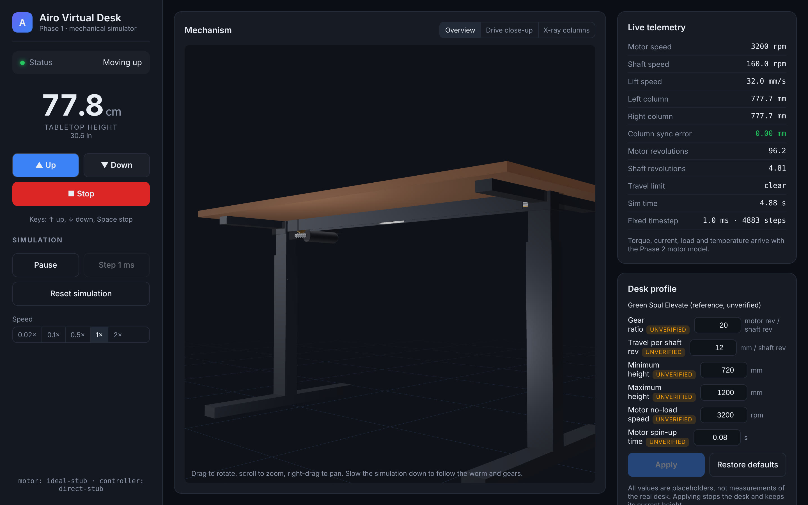
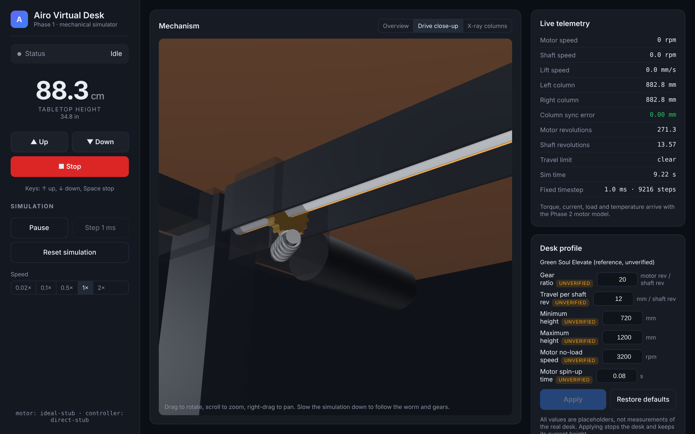
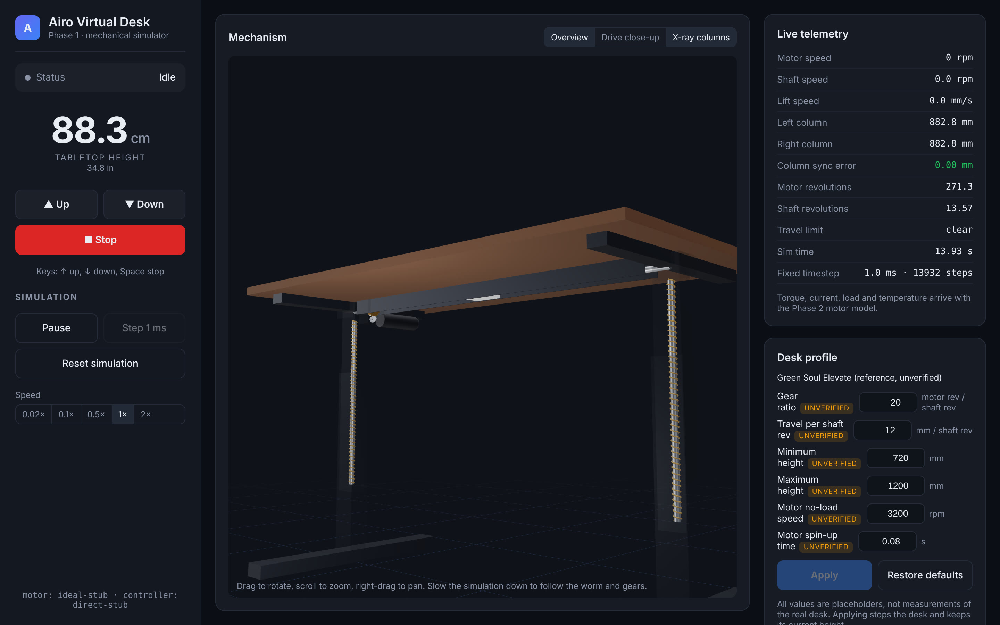

# Airo Virtual Desk Simulator

A browser-based 3D simulator of a motorised standing desk, built to design and test the **Airo Adaptive Drive** before any hardware exists. Press UP or DOWN and watch the motor turn the gearbox, the gearbox turn the hex shaft, and the shaft drive both lifting columns.

This is **Phase 1: mechanical visualisation** from the [PRD](docs/PRD.md). There is no real motor, no ESP32 and no adaptive control yet, only a mathematically consistent, configurable mechanism.



| Drive close-up | X-ray columns |
| --- | --- |
|  |  |

## Run it

```bash
npm install
npm run dev        # http://localhost:5173
npm test           # unit tests for the mechanical math and simulation
npm run build      # type-check and production build
```

Everything runs locally and offline.

**Controls:** UP / DOWN / STOP buttons, or the keyboard (↑, ↓, Space). Drag to orbit, scroll to zoom, right-drag to pan. Use the speed control (down to 0.02×) to slow the simulation and follow the worm and gear teeth.

## Architecture

The engine is split into modules under `src/packages/` so a real motor or a new controller can be swapped in without touching the rest.

| Module | Role | Phase 1 state |
| --- | --- | --- |
| `desk-profiles` | Desk, motor and mechanical parameters, each tagged `unverified` / `estimated` / `measured`; validation | Green Soul Elevate reference profile, all values **unverified placeholders** |
| `mechanical-engine` | Pure transmission equations and a per-step mechanism update with travel limits | Complete for a rigid single-motor drive |
| `motor-engine` | `MotorModel` interface | `IdealMotor` stub: speed follows command with a first-order lag, instant brake on STOP |
| `controller` | `Controller` interface (UP / DOWN / STOP in, duty cycle out) | `DirectController` stub, stops itself at travel limits |
| `simulation-engine` | Fixed-timestep clock wiring controller → motor → mechanics | 1 ms fixed step, pause / single step / speed / reset |
| `visualization` | React Three Fiber scene that only *reads* simulation snapshots | Tabletop, columns, crossbeam, motor, worm gearbox, primary and secondary hex shafts, coupling, lead screws |
| `src/app` | Dashboard UI | Controls, live telemetry, editable profile |

The engine packages import nothing from React or three.js. A test (`src/packages/architecture.test.ts`) enforces this boundary.

```
DeskCommand ──► Controller ──duty──► MotorModel ──rpm──► mechanical-engine ──► snapshot ──► visualization / telemetry
                    ▲                                         │
                    └──────────── height, travel limit ───────┘
```

### Fixed timestep

The browser loop only reports elapsed wall-clock time. `FixedStepClock` turns that into whole 1 ms steps, so results depend on simulated time and inputs, never on frame rate. The same run at 30 FPS and 144 FPS produces identical state; there is a test for this.

## Mechanical model

Two configurable parameters define the drive. Neither is hardcoded.

| Symbol | Profile field | Meaning | Placeholder |
| --- | --- | --- | --- |
| G | `mechanical.gearRatio` | motor revolutions per hex-shaft revolution | 20 (unverified) |
| L | `mechanical.travelPerShaftRevMm` | column travel per shaft revolution, mm (lumps the column bevel stage and lead screw) | 12 (unverified) |

```
shaft revolutions  = motor revolutions / G
column travel (mm) = shaft revolutions × L
shaft rpm          = motor rpm / G
lift speed (mm/s)  = motor rpm / G / 60 × L
```

Each step, the commanded motor speed is turned into requested travel. Travel is clamped to the min/max height, then shaft and motor rotation are recomputed from the travel that actually happened. Every part's angle therefore always agrees with the tabletop height. Both columns are driven by the same shaft through a rigid coupling, so their sync error is zero in Phase 1. Each column already has its own height in the state so uneven lifting can be added later.

With the placeholders (3200 rpm motor, G = 20, L = 12 mm) the desk lifts at 32 mm/s and the shaft turns at 160 rpm. These numbers only make the animation plausible. Replace them with measurements and change the parameter `status` to `measured`.

### What the 3D model assumes

The layout follows photos of the reference desk: one motor and gearbox at the left end of the crossbeam, motor axis perpendicular to the shaft, a long hex shaft inside the crossbeam channel, and a coupling in a white bearing block mid-span. The gearbox internals are drawn as a single-start worm stage because that gives a visual tooth count equal to the gear ratio. The real gearbox type is unknown. Proportions are approximate.

## Not in Phase 1

Load, torque, current and temperature (Phase 2 motor model); PID / adaptive control (Phase 3); faults and obstruction; height presets; multiple profiles and import/export; firmware simulation; Flutter UI. See the [roadmap](docs/PRD.md#13-development-roadmap).
