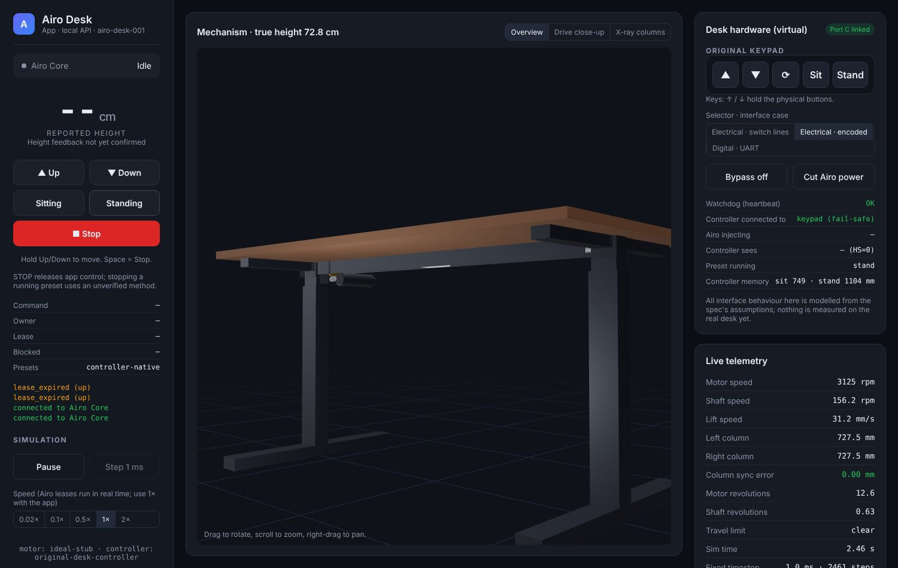

# Laptop end-to-end simulation (retrofit phase 1)

This is retrofit phase 1 from [RETROFIT_SPEC.md](RETROFIT_SPEC.md) section 16: the Airo firmware core runs on the laptop and drives the 3D desk, so the whole system can be tested before anything touches the real desk.



## Run it

You need Node 22, CMake 3.16 or newer, and a C++17 compiler.

```bash
npm install
npm run sim          # builds the firmware host, starts it on :8080 and the dashboard on :5173
```

Or in two terminals: `npm run airo` (firmware host) and `npm run dev` (dashboard). The dashboard reaches the host through Vite's proxy (`/api`, `/bridge`). Set `AIRO_HOST` to point the proxy elsewhere and `VITE_AIRO_TOKEN` if the host uses another token.

Without the host running, the dashboard still works as a desk with its original keypad. That is the fail-safe path, not a fallback mode.

## What runs where

```
 Dashboard "Airo Desk" panel (app)        UP · DOWN · Sitting · Standing · STOP
        │ REST /api/v1/commands, WebSocket /api/v1/ws (Bearer token)
        ▼
 airo-host  (C++, firmware/)              airo-core CommandService: the same code the ESP32-S3 will run
        │ HardwareAdapter = VirtualHardwareAdapter
        │ WebSocket /bridge  (stands in for Port C)
        ▼
 InterfaceBoard (TS, desk-hardware)       sense taps · injectors / UART · selector · watchdog · MANUAL ONLY
   ├─ Port A: VirtualKeypad               5 buttons on the right-hand panel (↑ / ↓ keys too)
   └─ Port B: OriginalDeskController      the desk's own controller: hold-to-run, one-touch presets, limits
        ▼
 Simulation (PR #1)                       motor → gearbox → hex shaft → columns → 3D view
```

| Piece | Where | Notes |
|---|---|---|
| Firmware command core | `firmware/airo-core/` | Portable C++17: no POSIX, ESP-IDF or Arduino includes. Leases, `request_id` dedupe, arbitration, state machine, limits, rate limit, config bounds. |
| Local API mapping | `firmware/airo-core/src/api.cpp` | Envelope parsing, status/event/error JSON. Shared with the future ESP32 transport. |
| Laptop host | `firmware/host/` | `VirtualHardwareAdapter`, a small HTTP/WebSocket server, `main.cpp`. |
| Virtual keypad, selector, interface board, original controller | `src/packages/desk-hardware/` | Desk-side models only. No Airo logic (conflict C8, enforced by `architecture.test.ts`). |
| Rig, bridge client, API client | `src/packages/airo-link/` | `DeskRig` runs keypad → board → controller → mechanism on one fixed clock. `AiroClient` is what an app would use. |
| Dashboard | `src/app/` | Left: the app (talks only to the API). Right: the virtual hardware. |

## The virtual selector

The selector has the three choices from the plan:

| Choice | Models | How Airo drives the controller |
|---|---|---|
| Electrical · switch lines | Case A1 | photoMOS injectors in parallel with each button |
| Electrical · encoded | Case A2 (and the button half of case C) | selector K1: keypad **or** Airo, never both |
| Digital · UART | Case B | selector K2 on HTX; Airo forwards keypad frames and inserts its own; height read from DTX |
| Bypass (MANUAL ONLY) | Panel switch, R6 | forces the keypad path and cuts injectors in hardware |

Per C7, the real board is built for one case; switching the case here models a different desk and reboots the core. "Cut Airo power" models pulling the Core's USB-C: the board's selector de-energises at once (R5) and the keypad works.

## Bridge protocol (`/bridge`)

JSON text frames. Board → core: `hello {case, manual_only, powered}`, `case`, `sense {lines}` (A1) or `sense {hs}` (A2), `uart {line: "htx"|"dtx", bytes}` (B), `bypass {on}`, `sim.power {on}`. Core → board: `hb` every 50 ms, `arm {on}`, `inject {lines}` (A1) or `inject {hs}` (A2), `uart {line: "htx", bytes}` (B).

The board enables injectors and the selector only while heartbeats arrive (200 ms watchdog, R7) and MANUAL ONLY is off.

## Presets and height feedback (Q14 / C4)

`presets_require_height_feedback` defaults to `false`: `desk.sitting` and `desk.standing` replay the controller's own presets without needing height feedback, as the spec recommends. Set it to `true` (`--set presets_require_height_feedback=true`, or `PATCH /api/v1/config` while idle) and presets are refused with `409 height_feedback_required` unless the interface reports height. In the simulation only the digital case reports height.

## Tests

| Command | What |
|---|---|
| `npm test` | TypeScript unit tests, including the keypad, board fail-safes and the original-controller model |
| `npm run firmware:test` | C++ unit tests for `airo-core`, the JSON/API layer, frames and the virtual adapter |
| `npm run test:e2e` | The spec's 12.1 matrix, end to end against the real `airo-host` binary, for each interface case. It runs twice: with `VirtualHardwareAdapter` over `/bridge`, and with the ESP32-S3 build's `Esp32HardwareAdapter` (`--adapter esp32`, bench mode, pin level over `/bench`) |
| `node scripts/hil.mjs` | The same scenario table against the ESP32-S3 on the bench, see [BENCH_TEST.md](BENCH_TEST.md) |

Spec 12.1 rows and where they are covered (the scenario table in `e2e/scenarios.ts` unless noted; `node scripts/hil.mjs --list` prints the ids):

| Row | Test |
|---|---|
| Physical UP / DOWN | "physical UP and DOWN buttons move the desk" ×3 cases |
| App `desk.up` / `desk.down` | "move the desk only while the lease is renewed" ×3 |
| `desk.sitting` / `desk.standing` | "reach the controller presets (no height feedback needed)" ×3 |
| Physical and app together | "app releases fast, keypad wins, no phantom preset" ×3; core release timing in `firmware/tests` |
| Airo power loss | "selector returns to the keypad path" ×3; process `SIGKILL` ×3 |
| Network disconnect during hold | "lease expires and movement stops" ×3 |
| Reconnect after drop | "no automatic restart" ×3 |
| Repeated `desk.up` with same `request_id` | "executes once" ×3 |
| `desk.stop` | "from a non-owner" ×3; "during a one-touch preset" ×3 |
| Upper/lower limit | "the desk never passes it" ×3; `direction_blocked` with feedback (case B) |
| Watchdog | Core hang via `SIGSTOP`; board unit tests (trip ≤ 200 ms) |
| MANUAL ONLY | "every app movement command is rejected and the keypad works" ×3 |

These prove the logic, not the electrical safety of a real circuit; bench stages T1–T7 still apply.

## Assumptions the simulation makes

Everything about the desk side is modelled from the spec's **[ASSUMPTION]** and **[COMMUNITY]** items, not measurements: hold-to-run arrows, one-touch presets (Q5), "any key stops a preset" (Q6), two arrows at once stop the motor (Q9), the circular-arrow key does nothing (Q4), keypad frames repeat every 50 ms and hold the motor for 150 ms, and the controller reports height every 200 ms in the digital case (Q7). The STOP method for a running preset (tap on lines, `0x2B` frame on UART) is unverified (7.3), so `stop_method_verified` stays `false`.

Spec 13.4's example height frame `F2 F2 01 03 05 06 07 14 7E` does not match its own checksum formula (`cmd + len + params` gives `0x16`). The code follows the formula.
