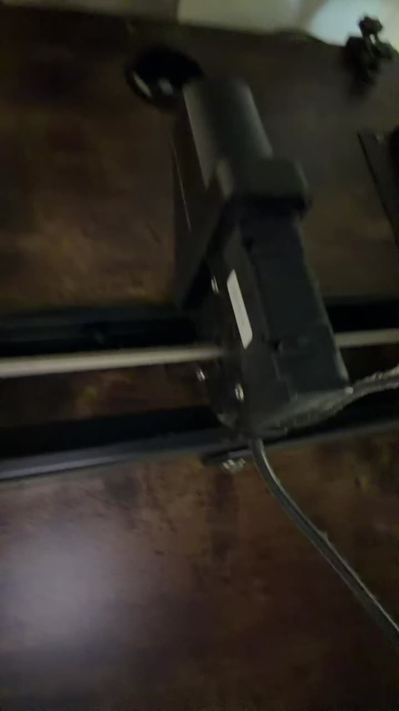
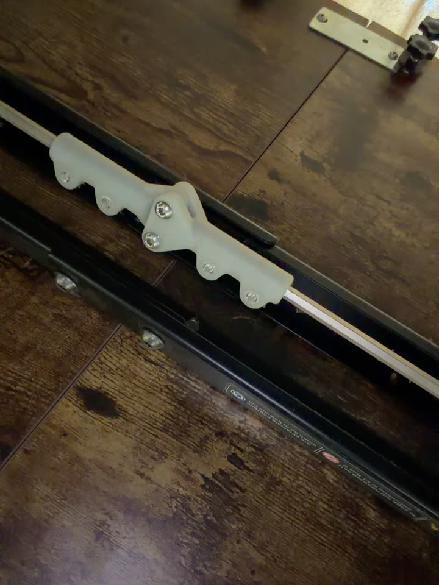
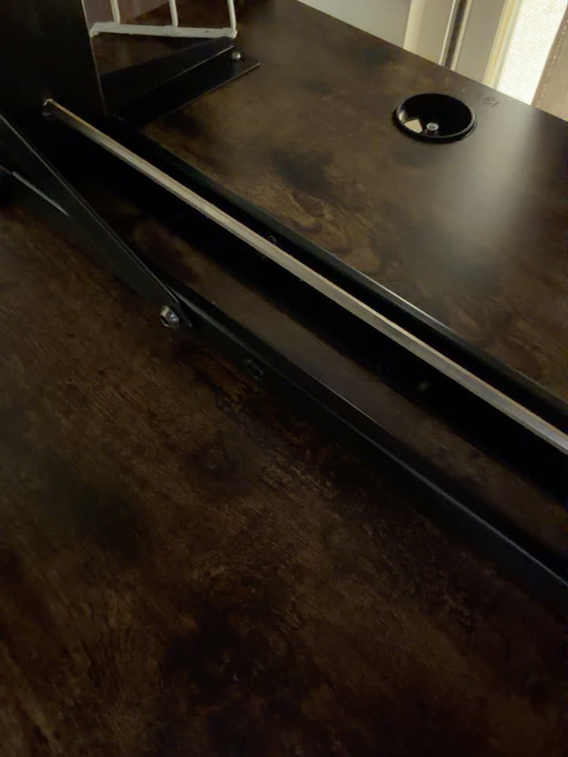
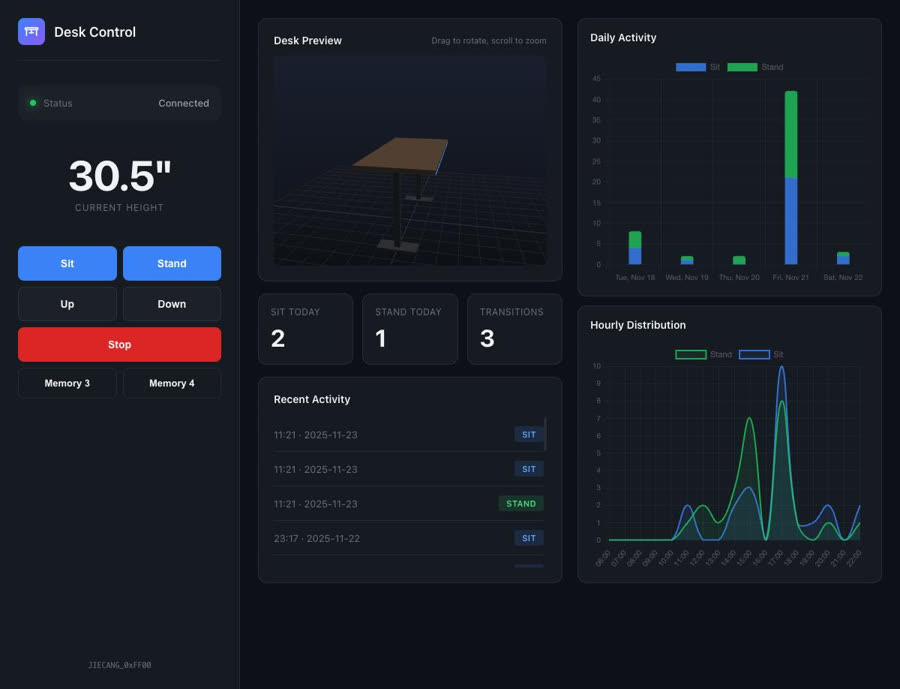

# Airo Virtual Desk Simulator: Product Requirements Document

| | |
| --- | --- |
| **Version** | 1.0 (draft) |
| **Date** | 14 November 2026 |
| **Product** | Airo Adaptive Drive |
| **Module** | Virtual Desk Simulator |
| **Scope** | Software-only MVP |
| **Status** | Initial product specification |

The product is a 3D interactive simulator for designing, understanding and testing the Airo Adaptive Drive system before building physical hardware. Its main objective is a virtual standing desk in which we can observe motor rotation, gearbox behaviour, hexagonal shaft movement, lifting-column movement and adaptive torque control.

> **Key architectural decision.** Keep the mechanical engine, motor engine and adaptive controller independent. This lets us replace the simulated motor with a real motor later without rewriting the application.

---

## 1. Product overview

### 1.1 Vision

Build an interactive 3D simulation environment that lets engineers design, visualise, simulate and test a universal adaptive standing-desk motor system without physical hardware.

The simulator will reproduce the mechanical and electrical behaviour of a standing desk, including:

- electric motor rotation
- gearbox transmission
- hexagonal synchronisation shaft rotation
- lifting-column movement
- tabletop height adjustment
- motor torque and speed
- load-dependent motor behaviour
- adaptive motor control
- fault and obstruction scenarios

It will eventually become the software test environment for the Airo Adaptive Drive platform.

### 1.2 Core principle

**Build the virtual product first, validate its behaviour, then build the physical product.**

- The simulator must not depend on the actual Green Soul desk or its controller.
- The Green Soul Elevate is the first reference configuration. Its unknown mechanical parameters are represented as configurable values.

---

## 2. Objectives

1. Create a realistic 3D standing-desk model.
2. Visualise how motor rotation moves the transmission shaft.
3. Demonstrate how shaft rotation translates into vertical desk movement.
4. Simulate different motor speeds and torque levels.
5. Simulate different tabletop loads.
6. Develop an adaptive motor-control algorithm.
7. Detect simulated overloads, stalls and obstructions.
8. Support different standing-desk configurations.
9. Provide a foundation for ESP32 firmware development.
10. Eventually support hardware-in-the-loop testing.

### Success criteria

- A user can raise and lower a virtual desk.
- Shaft rotation and lifting-column movement stay synchronised.
- Motor parameters can be changed during simulation.
- Different loads produce different simulated motor responses.
- The adaptive controller responds to load changes.
- Fault conditions trigger the defined safety response.
- Different desk configurations load without rewriting the simulation engine.

---

## 3. Target users

| User | Main purpose |
| --- | --- |
| Product engineer | Design the mechanical architecture |
| Embedded engineer | Develop motor-control firmware |
| Hardware engineer | Validate motor and driver selection |
| Developer | Build ESP32 and Flutter integration |
| Product designer | Understand the mechanism visually |

---

## 4. Application modules

### Module A: 3D mechanical simulator

An interactive 3D representation of a standing desk. Required components, each independently identifiable:

1. Tabletop
2. Left lifting column
3. Right lifting column
4. Horizontal crossbeam
5. Motor assembly
6. Gearbox
7. Primary hexagonal shaft
8. Secondary hexagonal shaft
9. Shaft coupling
10. Motor mounting brackets

Required interactions:

- rotate, zoom and pan the camera
- hide and show components
- switch between assembled and exploded views
- highlight the active transmission path
- observe shaft rotation
- observe vertical column movement

> **Reference desk note.** The PRD originally described a *central* motor assembly. The photos of the reference desk (section 17) show a single motor and gearbox mounted at one end of the crossbeam, perpendicular to a long hex shaft that runs inside the crossbeam channel. Motor position is therefore a profile parameter, not a fixed assumption.

### Module B: motor simulation engine

A configurable DC geared motor model.

| Parameter | Unit |
| --- | --- |
| Motor voltage | V |
| Motor current | A |
| Motor torque | Nm |
| Motor speed | rpm |
| Gear ratio | ratio |
| Motor efficiency | % |
| Shaft speed | rpm |
| Shaft torque | Nm |
| Motor temperature | °C |

The simulation calculates motor behaviour from its configured parameters. Start with a simplified DC motor model and introduce a more detailed electrical and thermal model later.

### Module C: mechanical transmission engine

Simulates motor rotation, gear reduction, output-shaft rotation, coupling behaviour, lifting-column displacement and vertical tabletop movement.

- The relationship between shaft rotations and desk height must be configurable.
- **Do not hardcode a specific gear ratio or shaft-to-height conversion.**

### Module D: adaptive torque controller

The core intelligence of Airo Adaptive Drive. It monitors requested movement, actual movement, motor current, motor speed, estimated torque, desk position, configured load and fault conditions, and adjusts motor output within validated limits.

Required behaviours:

1. Normal load compensation
2. Variable speed control
3. Current limiting
4. Stall detection
5. Obstruction detection
6. Position control
7. Emergency stop
8. Motor temperature protection

> **Important.** Motor current alone cannot distinguish an obstruction from a heavy load. The controller must use multiple signals and independent safety limits.

### Module E: desk configuration manager

The simulator supports multiple desk profiles. Each profile contains: desk name, mechanical architecture, number of motors, motor specifications, gearbox ratio, shaft profile, shaft dimensions, coupling configuration, lifting-column configuration, minimum height, maximum height, maximum permitted load, position feedback type and safety configuration.

Initial profiles:

1. Green Soul Elevate reference model
2. Generic single-motor standing desk
3. Generic dual-motor standing desk

Unknown parameters must be clearly marked as **estimated** or **unverified**.

---

## 5. User interface

The first screen should look like an engineering workbench rather than a consumer desk-control app. The 3D model occupies most of the screen, with motor controls and live telemetry around it. Visual style follows the existing dark *Desk Control* dashboard (section 17).

### 5.1 Main dashboard

| Panel | Contents |
| --- | --- |
| **Left: desk controls** | UP, DOWN, STOP, height presets, reset simulation |
| **Centre: 3D visualisation** | Interactive desk model, rotating shaft, moving lifting columns, motor and gearbox animation |
| **Right: live telemetry** | Current height, motor rpm, shaft rpm, torque, current, load, temperature, simulation status |
| **Bottom: simulation timeline** | Motor activity, load changes, torque changes, fault events, position history |

### 5.2 Motor configuration

Users can modify motor voltage, rated current, maximum current, motor rpm, rated torque, gear ratio and motor efficiency.

### 5.3 Load configuration

Tabletop load can be changed while the simulation runs. Initial test values:

| Scenario | Simulated load |
| --- | --- |
| Empty | 0 kg |
| Light | 20 kg |
| Medium | 40 kg |
| Heavy | 60 kg |

These are simulation test cases, not validated Green Soul load limits.

### 5.4 Simulation controls

Simulation speed, pause, resume, reset, single-step execution, enable/disable adaptive controller, enable/disable fault injection, and switch desk profile.

---

## 6. Mechanical simulation requirements

The mechanical engine maintains consistent relationships between motor rotation, gearbox output, shaft rotation, lifting-mechanism movement and tabletop displacement. These relationships are configurable. For example, if a lifting mechanism moves 1 mm for every N shaft rotations, tabletop position is calculated from that configured relationship.

To be introduced progressively:

- uneven loading
- different column movement rates
- shaft coupling failure
- mechanical resistance
- gearbox friction
- backlash
- mechanical travel limits

---

## 7. Adaptive control requirements

### 7.1 Layered architecture

| Layer | Responsibility |
| --- | --- |
| 1. Position controller | Target height, actual height, position error |
| 2. Speed controller | Requested speed, actual speed, speed correction |
| 3. Current / torque controller | Requested torque, actual current, current limit, torque limit |
| 4. Safety controller | Stall detection, unexpected resistance, temperature limit, travel limits, emergency stop |

### 7.2 Adaptive behaviour

The controller adjusts its output automatically when the simulated load changes:

| Situation | Expected response |
| --- | --- |
| Empty desk | Lower torque demand |
| Increased load | Higher torque demand |
| Reduced load | Lower torque demand |
| Unexpected obstruction | Stop movement |
| Motor stall | Enter fault state |

The controller must never exceed configured electrical, mechanical or thermal limits.

### 7.3 Algorithm

Start with a conventional closed-loop controller: PID position control, speed control, current limiting, torque estimation and rule-based load adaptation. **No machine learning until the baseline control system works reliably.**

---

## 8. Fault simulation

Each fault generates an event with a timestamp and diagnostic information.

| Fault | Expected response |
| --- | --- |
| Motor stall | Stop movement |
| Excessive current | Limit or stop motor |
| Obstruction | Stop movement |
| Upper travel limit | Prevent further upward movement |
| Lower travel limit | Prevent further downward movement |
| Encoder failure | Stop and report sensor fault |
| Uneven lifting | Detect movement mismatch |
| Overtemperature | Enter protective state |
| Communication loss | Expire movement command and stop |
| Controller failure | Enter simulated fault state |

---

## 9. Technology stack

| Area | Choice |
| --- | --- |
| Frontend and 3D | TypeScript, React, Three.js, React Three Fiber, Drei |
| Physics and mechanics | Rapier.js for collision and rigid bodies; custom equations for gearbox and lifting; configurable shaft-to-height relationships |
| Motor simulation | Custom DC motor model; optional future MATLAB Simulink / Simscape integration |
| Simulation API | TypeScript simulation engine, WebSocket telemetry, REST configuration API, JSON desk profiles |
| Future embedded | ESP32, ESP-IDF, C++ motor-control firmware, hardware abstraction layer, sensor interfaces |
| Deployment | Browser-based, offline-first, local simulation with no cloud dependency |

---

## 10. Software architecture

The system is split into independent packages.

| # | Package | Responsible for |
| --- | --- | --- |
| 1 | `mechanical-engine` | Shaft rotation, gear ratios, column movement, mechanical constraints, tabletop position |
| 2 | `motor-engine` | Motor speed, torque, current, voltage, temperature estimation |
| 3 | `adaptive-controller` | PID control, speed regulation, current limiting, load adaptation, safety state machine |
| 4 | `simulation-engine` | Simulation clock, time-step management, state updates, scenario execution, fault injection |
| 5 | `desk-profiles` | Desk, motor and mechanical configuration; profile validation |
| 6 | `visualization` | Three.js scene, mechanical animation, camera controls, telemetry visualisation |
| 7 | `application` | Dashboard, controls, settings, scenario selection, simulation reports |

---

## 11. Simulation scenarios

1. **Normal movement.** Start at minimum height, press UP, observe motor and shaft rotation and both lifting columns, stop at target height.
2. **Load adaptation.** Start with 20 kg, begin moving up, increase load to 40 kg, observe current and torque response, verify speed regulation.
3. **Direction reversal.** Move up, press STOP, wait for the motor to stop, command DOWN, verify correct reverse operation.
4. **Mechanical obstruction.** Begin moving up, introduce simulated resistance, verify the controller detects abnormal behaviour, stops the motor and generates a fault event.
5. **Uneven loading.** Apply different loads to the two sides, observe column movement, detect excessive synchronisation error, trigger a protective stop when the configured threshold is exceeded.
6. **Multiple desk profiles.** Load the Green Soul reference, generic single-motor and generic dual-motor profiles and verify the engine works with all three.

---

## 12. Non-functional requirements

**Performance**

- Target 60 FPS for the 3D interface on supported desktop hardware.
- Configurable simulation time step.
- Control calculations independent of rendering frame rate.
- Smooth telemetry updates; pause and reset behave consistently.

**Reliability**

- Deterministic simulation with a fixed time step and identical inputs.
- No uncontrolled movement after a simulation reset.
- No automatic movement after fault recovery.
- Invalid configurations are rejected.

**Maintainability**

- Modular architecture with typed interfaces.
- Unit and integration tests.
- Documented simulation equations.
- Versioned desk profiles.

**Offline operation.** All core simulation functions work without internet connectivity.

---

## 13. Development roadmap

### Initial priority order

1. **3D standing desk:** visible tabletop, columns, motor, gearbox and shaft.
2. **Mechanical animation:** shaft rotation drives the lifting columns.
3. **Motor physics:** rpm, torque, current and load.
4. **Adaptive control:** automatic speed and torque adjustment.
5. **Fault simulation:** obstruction, stall, overload and emergency stop.

### Phases

| Phase | Deliverables | Acceptance criteria |
| --- | --- | --- |
| **1. Mechanical visualisation** | 3D desk, motor assembly, gearbox, hex shaft, coupling, lifting columns, UP/DOWN animation | UP rotates the shaft and raises the tabletop. DOWN reverses movement. STOP immediately stops movement. Both columns stay synchronised. |
| **2. Motor simulation** | DC motor model, gearbox ratio, rpm, torque and current calculation, configurable load | Changing motor parameters changes the output. Changing load changes motor behaviour. Telemetry matches the mathematical model. |
| **3. Adaptive controller** | PID controller, current limiting, speed regulation, load adaptation, position control | Configured speed is maintained under changing loads. Current and torque stay within limits. Faults stop movement. |
| **4. Multi-desk support** | Profile manager, different motor and transmission configurations, import/export | New profiles can be created without changing core simulation code. |
| **5. ESP32 firmware simulation** | Firmware architecture, HAL, simulated sensor inputs, local API, WebSocket communication | The same control logic runs against simulated hardware and a future physical adapter. |
| **6. Hardware-in-the-loop** | ESP32 board, external motor driver, encoder feedback, current sensing, test motor and gearbox | Virtual and physical motor responses can be compared. Safety limits are independently validated. |

After the simulator, the plan continues with the Flutter interface.

---

## 14. Out of scope for the MVP

- Controlling the real Green Soul desk
- Intercepting its existing controller signals
- Removing the original motor
- Connecting an ESP32 to the desk
- Physical motor installation
- Automatic discovery of real desk hardware
- Machine-learning-based torque control
- Cloud services
- Commercial multi-user management

The MVP is a software-only simulator.

---

## 15. Testing and quality assurance

- **Unit tests:** motor equations, gearbox calculations, shaft rotation, position calculations, torque calculations, PID controller, safety state machine.
- **Integration tests:** motor and gearbox, shaft and lifting columns, controller and simulation, profile loading, fault handling.
- **Regression tests:** every change to mechanical equations or motor behaviour runs against fixed reference scenarios.
- **Simulation accuracy:** the simulator distinguishes between mathematical correctness, agreement with a configured theoretical model, and agreement with measured real hardware.

> A successful simulation does not establish real-world mechanical safety.

---

## 16. Key product risks

| Risk | Mitigation |
| --- | --- |
| Unknown gearbox specifications | Configurable parameters |
| Unknown motor characteristics | Separate motor profiles |
| Incorrect mechanical model | Validate equations, later compare with measurements |
| Unrealistic torque response | Use motor and load models |
| Physics / rendering mismatch | Separate simulation clock |
| Incorrect obstruction detection | Multi-sensor model and independent limits |
| Universal compatibility assumptions | Require mechanical compatibility profiles |

---

## 17. Reference material

### Reference desk (Green Soul Elevate), observed

| | |
| --- | --- |
|  |  |
| Single motor with its gearbox at one end of the crossbeam, motor axis perpendicular to the shaft. | Long hex shaft inside the crossbeam channel, held by a white plastic bearing/support block. |
|  | |
| Shaft runs the full width inside an open steel channel. | |

Observations used for the Phase 1 model (all **unverified** until measured):

- One motor drives both columns through a single long hex shaft (single-motor, shaft-synchronised architecture).
- The motor and gearbox sit at one end, not in the centre.
- A white bearing/coupling block supports the shaft mid-span.
- Gearbox type, ratio, shaft size and column lead are unknown.

### Existing dashboard style

Dark theme, a left control column with a large height readout, Up/Down and a red Stop, cards for the 3D preview and data.

### External references

- LINAK desk systems: <https://www.linak.com/work-res/desk-systems>
- SitStand Bluetooth desk controller write-up: <https://gregraiz.com/blog/sitstand-bluetooth-desk-controller/>

---

## 18. Final MVP definition

The first release is complete when a user can:

1. Open the Airo Virtual Desk Simulator.
2. Load the default standing-desk profile.
3. See a 3D desk with its mechanical components.
4. Press UP and observe the transmission mechanism.
5. Press DOWN and reverse the mechanism.
6. Adjust simulated motor rpm.
7. Adjust motor torque limits.
8. Change tabletop load.
9. Observe live motor and mechanical telemetry.
10. Run and inspect basic fault scenarios.
11. Save and load simulation configurations.

**The first release does not need real-world physics accuracy. It must have mathematically consistent, configurable mechanical behaviour and a clear path to higher-fidelity simulation.**

---

## 19. Product direction

The simulator becomes the engineering foundation of Airo Adaptive Drive, allowing the team to design motor assemblies, test gear ratios, compare mechanical configurations, tune adaptive control algorithms, validate fault handling, test ESP32 firmware and prepare real hardware prototypes.

**Final product principle:** every physical hardware design should have a corresponding virtual configuration that can be tested before deployment.
